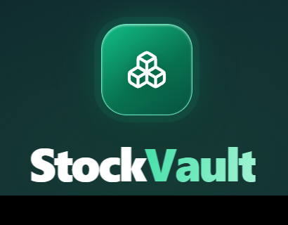
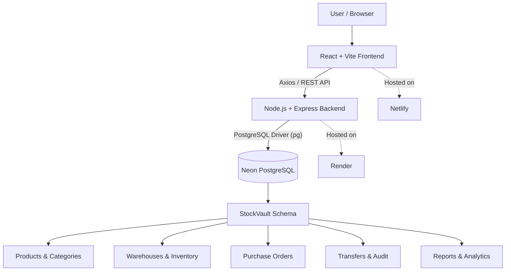

<div align="center">




### Intelligent Inventory. Seamless Operations. Complete Control.

A full-stack, multi-warehouse inventory management system built with React, Node.js, Express and PostgreSQL.

<br/>

[](https://stockvault-inventory.netlify.app)
[](https://github.com/HarshKamboj25/StockVault-SQL)

<br/>


</div>

---

## ✨ Overview

**StockVault** is a full-stack inventory management platform designed to simplify inventory operations across multiple warehouses.

It brings product management, warehouse operations, stock monitoring, purchasing, supplier coordination, stock transfers and analytical reporting together in one centralized application.

The project combines a modern React interface with a RESTful Express backend and a PostgreSQL relational database.

It also demonstrates database engineering concepts such as relational modelling, constraints, SQL functions, stored procedures, triggers, transactions, indexing and analytical schemas.

## 🚀 Live Application

| Component | Deployment |
|---|---|
| Frontend | [Netlify](https://stockvault-inventory.netlify.app) |
| Backend API | [Render](https://stockvault-sql.onrender.com) |
| API Health | [Check API and Database](https://stockvault-sql.onrender.com/api/health) |
| Source Code | [GitHub Repository](https://github.com/HarshKamboj25/StockVault-SQL) |

The application uses a hosted PostgreSQL database through Neon.

## 🎯 Key Features

### 📊 Dashboard
- Centralized inventory overview.
- Total products and warehouse statistics.
- Stock quantity and inventory valuation.
- Low-stock alerts and pending purchase orders.
- Stock distribution and warehouse overview.

### 📦 Product Management
- Create and manage product records.
- Browse product categories.
- Update product information.
- Deactivate products.

### 🏢 Warehouse Management
- Manage multiple warehouse locations.
- View warehouse-specific inventory.
- Track stock across storage locations.

### 📋 Inventory Management
- Monitor warehouse-wise stock quantities.
- View inventory levels.
- Track stock availability.

### 🛒 Purchase Order Management
- Create purchase orders.
- Review and approve orders.
- Receive inventory, including partial receipts.
- Track purchase order status.

### 🤝 Supplier Management
- Maintain supplier records.
- Add and update supplier information.
- Coordinate supplier-related operations.

### 🔄 Stock Transfers
- Record inventory transfers between warehouses.
- Execute database-backed stock transfer operations.
- Maintain stock movement records.

### 🔔 Reorder Alerts
- View low-stock products.
- Generate reorder alerts.
- Identify products requiring replenishment.

### 📈 Reports and Analytics
- Inventory valuation.
- Warehouse performance.
- Supplier performance.
- Purchase order analytics.
- Stock movement reports.
- Low-stock analytics.

### 👤 Profile Management
- Manage store profile information.
- Maintain account and company details.

---

## 🧰 Technology Stack

<div align="center">

| Layer | Technologies |
|---|---|
| Frontend | React 19, JavaScript, HTML5, CSS3 |
| Build Tool | Vite 8 |
| Routing | React Router |
| HTTP Client | Axios |
| Charts | Recharts |
| Icons | Lucide React |
| Backend | Node.js, Express 5 |
| Database | PostgreSQL 16+ |
| Database Driver | node-postgres (`pg`) |
| Environment Configuration | dotenv |
| Frontend Hosting | Netlify |
| Backend Hosting | Render |
| Database Hosting | Neon |
| Version Control | Git and GitHub |

</div>

## 🏗️ System Architecture



### Request Flow

1. The user interacts with the React frontend.
2. Axios sends HTTP requests to the Express API.
3. Backend route handlers process the request.
4. PostgreSQL executes the required queries and business operations.
5. The backend returns JSON responses.
6. The frontend updates the interface with the latest data.

---

## 📁 Project Structure

```text
StockVault-SQL/
│
├── backend/
│   ├── config/
│   │   └── db.js
│   ├── routes/
│   │   ├── alertRoutes.js
│   │   ├── dashboardRoutes.js
│   │   ├── productRoutes.js
│   │   ├── purchaseOrderRoutes.js
│   │   ├── reportRoutes.js
│   │   ├── supplierRoutes.js
│   │   ├── transferRoutes.js
│   │   └── warehouseRoutes.js
│   ├── server.js
│   └── package.json
│
├── frontend/
│   ├── public/
│   ├── src/
│   │   ├── pages/
│   │   ├── App.jsx
│   │   ├── App.css
│   │   └── main.jsx
│   └── package.json
│
├── docs/
│   ├── DESIGN_NOTES.md
│   ├── ER_DIAGRAM.md
│   ├── ER_MODEL.md
│   └── STAR_SCHEMA.md
│
├── sql/
│   ├── 01_schema.sql
│   ├── 02_seed_data.sql
│   ├── 03_queries.sql
│   ├── 04_views_indexes.sql
│   ├── 05_transactions.sql
│   ├── 06_security.sql
│   ├── 07_performance.sql
│   └── 08_analytics_star_schema.sql
│
├── outputs/
├── .gitignore
└── README.md
```

## ⚙️ Getting Started

Follow these instructions to run StockVault locally.

### Prerequisites

Install the following:

- [Node.js](https://nodejs.org/)
- [PostgreSQL 16+](https://www.postgresql.org/download/)
- [Git](https://git-scm.com/)
- [Visual Studio Code](https://code.visualstudio.com/)

### 1. Clone the Repository

```bash
git clone https://github.com/HarshKamboj25/StockVault-SQL.git
cd StockVault-SQL
```

### 2. Set Up the Database

Create the PostgreSQL database:

```bash
createdb -h localhost -U postgres stockvault_db
```

Execute the SQL scripts from the project root in the required order:

```bash
psql -h localhost -U postgres -d stockvault_db -v ON_ERROR_STOP=1 -f ./sql/01_schema.sql

psql -h localhost -U postgres -d stockvault_db -v ON_ERROR_STOP=1 -f ./sql/02_seed_data.sql

psql -h localhost -U postgres -d stockvault_db -v ON_ERROR_STOP=1 -f ./sql/03_queries.sql

psql -h localhost -U postgres -d stockvault_db -v ON_ERROR_STOP=1 -f ./sql/04_views_indexes.sql

psql -h localhost -U postgres -d stockvault_db -v ON_ERROR_STOP=1 -f ./sql/05_transactions.sql

psql -h localhost -U postgres -d stockvault_db -v ON_ERROR_STOP=1 -f ./sql/07_performance.sql

psql -h localhost -U postgres -d stockvault_db -v ON_ERROR_STOP=1 -f ./sql/08_analytics_star_schema.sql
```

**Important:** `01_schema.sql` drops and recreates the `stockvault` schema. Run these setup scripts only against a dedicated database that can safely be initialized. Run the seed script only once after schema creation.

The security script contains role-creation instructions that require separate administrator setup. Do not execute its original role-creation block without reviewing the project security notes.

### 3. Configure the Backend

Navigate to the backend directory:

```bash
cd backend
npm install
```

Create a `.env` file inside `backend/`:

```env
DB_HOST=localhost
DB_PORT=5432
DB_NAME=stockvault_db
DB_USER=postgres
DB_PASSWORD=your_postgresql_password
PORT=5000
```

Replace the example database credentials with your own local PostgreSQL credentials.

### 4. Start the Backend

```bash
npm run dev
```

The backend runs at:

```text
http://localhost:5000
```

### 5. Configure the Frontend

Open another terminal:

```bash
cd frontend
npm install
```

Create a `.env` file inside `frontend/`:

```env
VITE_API_URL=http://localhost:5000/api
```

### 6. Start the Frontend

```bash
npm run dev
```

Open the local Vite URL shown in the terminal, normally:

```text
http://localhost:5173
```

---

## 🔌 API Reference

Base URL:

```text
/api
```

| Module | Method | Endpoint | Description |
|---|---|---|---|
| Dashboard | GET | `/dashboard/stats` | Dashboard statistics |
| Products | GET | `/products` | List products |
| Products | POST | `/products` | Create product |
| Products | PUT | `/products/:id` | Update product |
| Products | PATCH | `/products/:id/deactivate` | Deactivate product |
| Products | GET | `/products/categories` | Product categories |
| Warehouses | GET | `/warehouses` | List warehouses |
| Warehouses | GET | `/warehouses/:id/inventory` | Warehouse inventory |
| Alerts | GET | `/alerts` | List reorder alerts |
| Alerts | POST | `/alerts/generate` | Generate alerts |
| Purchase Orders | GET | `/purchase-orders` | List purchase orders |
| Purchase Orders | POST | `/purchase-orders` | Create purchase order |
| Purchase Orders | GET | `/purchase-orders/:id` | Get order details |
| Purchase Orders | PATCH | `/purchase-orders/:id/approve` | Approve order |
| Purchase Orders | POST | `/purchase-orders/:id/receive` | Receive inventory |
| Suppliers | GET | `/suppliers` | List suppliers |
| Suppliers | POST | `/suppliers` | Create supplier |
| Suppliers | PUT | `/suppliers/:id` | Update supplier |
| Transfers | GET | `/transfers` | List stock transfers |
| Transfers | POST | `/transfers` | Create stock transfer |
| Reports | GET | `/reports` | Retrieve analytics |

Health check:

```text
GET /api/health
```

The health endpoint checks the PostgreSQL connection and returns database information.

---

## 🗄️ Database Engineering

StockVault is also a database-focused academic project demonstrating practical relational database engineering.

### Core Database Concepts

- Entity Relationship modelling.
- Primary keys and foreign keys.
- Constraints and relational integrity.
- Normalization concepts.
- DDL and DML.
- Joins, subqueries and aggregate functions.
- Common Table Expressions (CTEs).
- Window functions.
- Views and indexes.
- Transactions, COMMIT, ROLLBACK and SAVEPOINT.
- PL/pgSQL functions and stored procedures.
- Explicit cursors.
- Triggers and audit logging.
- Database roles and privileges.
- EXPLAIN ANALYZE and query optimization.

### Database Modules

| Module | Purpose |
|---|---|
| Products | Product and category records |
| Suppliers | Supplier information |
| Warehouses | Multiple storage locations |
| Inventory | Warehouse-wise stock |
| Purchase Orders | Purchasing workflow |
| Transfers | Inventory movement |
| Audit | Stock change history |
| Analytics | Reporting and warehouse analysis |
| Security | Database roles and privileges |

### Analytical Star Schema

The project includes a small analytical schema containing:

- `dim_date`
- `dim_product`
- `dim_warehouse`
- `fact_stock_snapshot`

This supports analytical reporting across products, warehouses, dates, quantities and inventory value.

---

## 🌐 Deployment Architecture

StockVault is deployed using separate hosting services for its application layers.

| Layer | Platform |
|---|---|
| Frontend | Netlify |
| Backend | Render |
| PostgreSQL Database | Neon |

Production frontend:

https://stockvault-inventory.netlify.app

Production backend:

https://stockvault-sql.onrender.com

The frontend uses the `VITE_API_URL` environment variable to communicate with the deployed backend.

The backend database connection is configured through environment variables. Never commit real `.env` files, database passwords or private credentials.

---

## 🔒 Security Notes

- Keep database credentials in environment variables.
- Never commit `.env` files.
- Use private credentials for database users.
- Restrict production database access appropriately.
- Review SQL security and role permissions before deployment.
- Do not expose sensitive connection strings in screenshots or documentation.

## 🧪 Verification

The application has been deployed with a live frontend, backend API and PostgreSQL database connection.

The backend health endpoint provides a database connectivity check.

The dashboard API provides live inventory statistics from the database.

## 🔮 Future Enhancements

Potential directions for future development:

- Role-based authentication and access control.
- Barcode and QR-code inventory operations.
- Automated purchase order notifications.
- Advanced forecasting and demand prediction.
- CSV and PDF report exports.
- More detailed audit history and activity tracking.
- Mobile-friendly inventory workflows.

## 📚 Documentation

Additional project documentation is available in the `docs/` directory:

- [Design Notes](docs/DESIGN_NOTES.md)
- [ER Diagram](docs/ER_DIAGRAM.md)
- [ER Model](docs/ER_MODEL.md)
- [Star Schema](docs/STAR_SCHEMA.md)

SQL implementation scripts are available in the `sql/` directory.

## 🤝 Contributing

Contributions, suggestions and improvements are welcome.

1. Fork the repository.
2. Create a feature branch.
3. Commit your changes.
4. Push the branch.
5. Open a pull request describing your contribution.

## 👨‍💻 Project Information

| Detail | Description |
|---|---|
| Project | StockVault |
| Category | Full-Stack Inventory Management |
| Database | PostgreSQL |
| Backend | Node.js and Express |
| Frontend | React and Vite |
| Deployment | Netlify, Render and Neon |

---

<div align="center">

### Built to bring inventory operations under one roof.

**StockVault | Smart Commerce & Multi-Warehouse Inventory Management**

[](https://stockvault-inventory.netlify.app)

<br/>


</div>