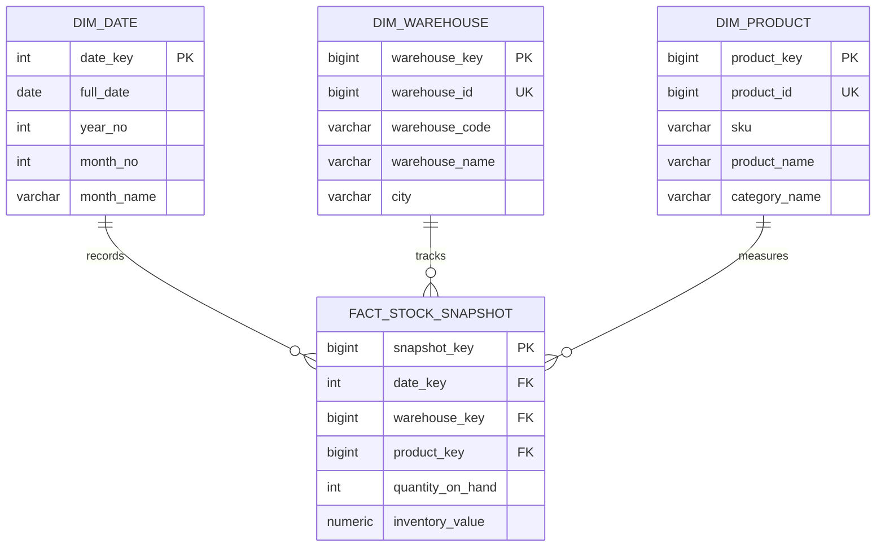

# StockVault SQL - Star Schema Diagram

## Explanation

The fact_stock_snapshot table stores inventory snapshot measurements. It references three dimension tables: dim_date, dim_warehouse and dim_product.

The measures are quantity_on_hand and inventory_value. The dimensions provide the date, warehouse and product context for analytical reporting.
